# 화면 모음: 집키미 (자취방 보증금 지킴이)

- 촬영: 2026-11-14, Chrome(Chromium) 한국어 설정. 휴대폰은 390px 폭을 2배 해상도로, PC는 1280px 폭으로 페이지 전체를 찍었다.
- 읽은 내용 확인 화면의 [위험 신호 검사] 줄은 실제로는 화면 아래에 고정된다. 캡처에서만 페이지 맨 끝에 보이게 했다.
- 캡처는 AI를 부르지 않는 상태(키를 비운 서버)로 찍었다. 그래서 서류 올리기 화면은 서류를 읽을 수 있는 상태로 가정해 찍었고(키가 없으면 제목 아래에 빨간 안내 한 줄이 더 나온다), 분석 중 화면은 서버 응답을 붙잡아 둔 채 찍었다. 분석 실패 화면은 키가 없는 서버의 실제 응답 그대로다. 22는 서류 읽기 응답만 예시 C의 값으로 바꿔 넣어 찍었다.
- 17·18의 계약서 사진은 캡처용으로 따로 만든 가상 이미지다(이름·주민등록번호·전화번호 모두 가짜). 19·22의 PDF는 demo-docs의 가상 서류다.
- 캡처 속 휴대폰 폭 화면은 마우스로 찍어서 보내기 줄이 컴퓨터용(PDF 내려받기 · 요약 글 공유하기 · 메일로 보내기 · 인쇄하기)으로 나온다. 실제 휴대폰에서는 'PDF로 공유하기 · 요약 글 공유하기'만 보인다.
- 08은 브라우저의 인쇄(A4)로 만든 PDF의 1쪽을, 21은 [PDF 내려받기]로 만든 검토서 PDF의 쪽 그림을 그대로 옮긴 것이다. 09는 예시 A에서 계약서만 뺀 입력을 검사한 결과다.

## 01. 시작 · 휴대폰

왼쪽 위 집키미 로고(누르면 언제든 처음 화면), "사인할 계약서를 등기부와 맞춰 보고…" 소개 한 줄, 준비할 서류 표, 주 버튼 [서류 올리기]와 '이미 계약했다면: 계약 후 재확인' 링크, 예시 결과 링크 A·B·C와 그 아래 '계약 후 재확인 예시: A 집, 잔금 이틀 전 근저당이 생긴 경우', '수정 전·후 비교 예시: C 집, 요청서대로 계약서를 고친 경우', 맨 아래 고지 한 줄과 '개인정보 처리 안내' 링크.

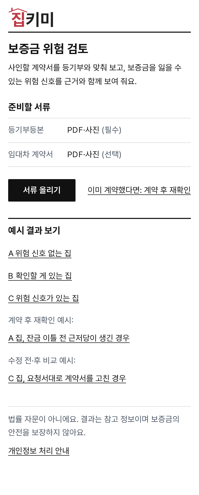

## 01. 시작 · PC

최대 폭 640px 한 단 문서. 버튼은 글자 길이만큼만 차지한다.

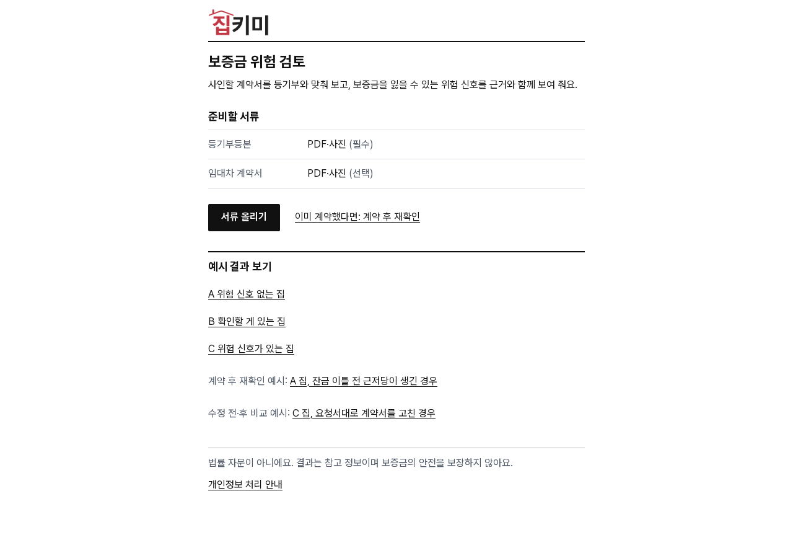

## 02. 서류 올리기 · 빈 상태

등기부등본(필수)·계약서(선택) 줄과 형식 안내 한 줄(PDF나 사진, 여러 장이면 한 번에, 파일 하나 10MB·서류마다 30쪽), '계약서가 아직 없으면 직접 입력' 펼치기 줄, 등기부 받는 방법. 맨 아래에 전송 고지("올린 서류는 내용을 옮겨 적기 위해 OpenAI(미국)로 전송돼요…")와 '개인정보 처리 안내' 링크, '위 내용을 확인했어요' 체크. 등기부를 고르고 체크해야 [분석하기]가 켜진다.

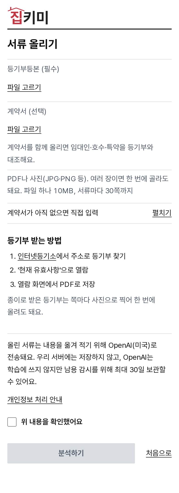

## 02. 서류 올리기 · 채운 상태

등기부 PDF를 고르고, '직접 입력'을 펼쳐 보증금·월세·계약 예정일·임대인 이름을 넣고, 전송 고지에 체크한 상태.

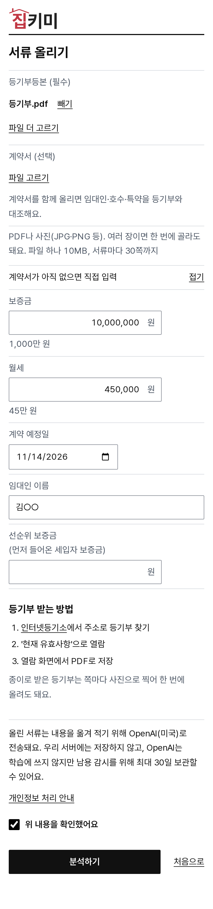

## 03. 분석 중

제목에 경과 시간, 아래에 단계 표(등기부 · 계약서 · 위험 신호 확인)와 '취소' 링크.

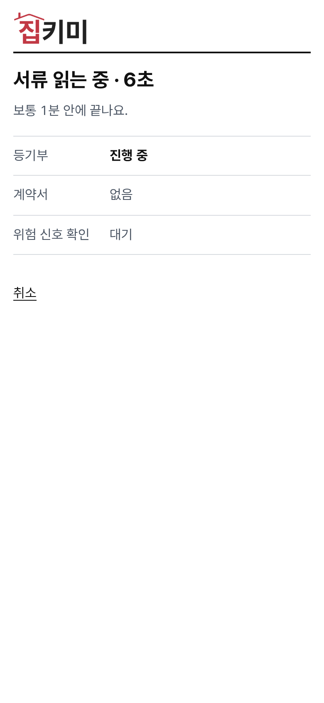

## 03. 분석 실패

문서를 읽지 못했을 때: [다시 시도], '서류 다시 고르기', 예시 결과 링크.

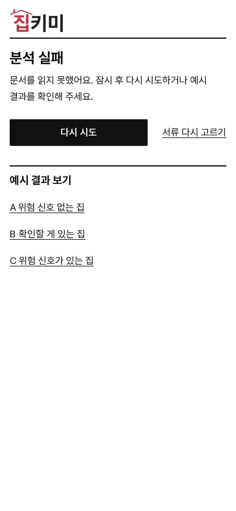

## 04. 읽은 내용 확인 · 예시 C · 휴대폰

등기부, 갑구, 을구, 계약서, 알고 있는 금액, 함께 확인한 자료를 위에서 아래로 확인하고 고친다. 갑구·을구 제목 아래에 어떤 기록이 적힌 곳인지 한 줄씩 있고, 그 안의 압류·근저당·채권최고액은 점선 밑줄을 누르면 풀이가 나온다.

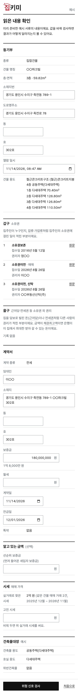

## 04. 읽은 내용 확인 · 예시 C · PC

라벨 | 입력 두 칸 표. 갑구는 순위 · 목적 · 접수일 · 권리자 · 금액 표이고 줄마다 '원문' 링크가 있다. 실제로 서류를 올린 경우에는 등기부·계약서 제목 오른쪽에 [원문 보기]가 있다(22).

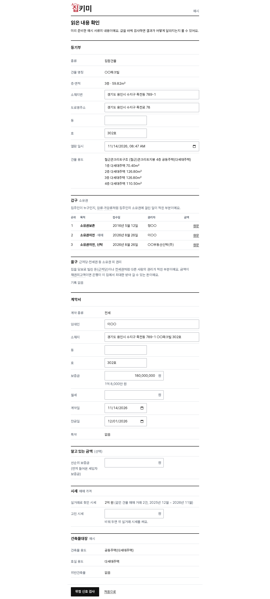

## 05. 검토서 · 예시 A

종합 판정 '큰 위험 신호 없음'. 1절 대조표 다섯 줄이 모두 초록 글자(일치 · 5% · 변경 없음 · 특약 있음)이고, 3절 요청서에는 고칠 곳 없이 가. 특약, 나. 받을 서류만 있다.

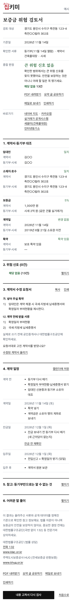

## 05. 검토서 · 예시 B

종합 판정 '추가 확인 필요'. 1절 대조표, 2절 위험 신호 주의 5건 · 확인 못 함 1건, 3절 계약서 수정 요청서.

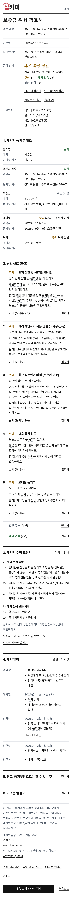

## 05. 검토서 · 예시 C · 휴대폰

종합 판정 '계약 보류 권장'과 그 아래 보내기 줄·바로가기(지도·실거래가·세움터·인터넷등기소). 1절 대조표에서 계약서 임대인 '이○○'와 등기부 '○○부동산신탁(주)'가 불일치. 2절 위험 신호는 쉬운 이름을 앞에, 공식 용어를 괄호에 둔다(집주인이 아닌 사람과 계약 (임대인·소유자 불일치), 신탁회사 소유 (신탁등기) …). 위임장·근저당·확정일자 같은 말에는 옅은 점선 밑줄이 있다. 3절 계약서 수정 요청서(가. 고칠 곳 · 나. 특약 · 다. 받을 서류)와 '수정된 계약서 올리기' 링크, 4절 계약 일정의 잔금일 줄에 '잔금 전 재확인' 링크, 맨 아래 접힌 '참고'와 '어려운 말 풀이', 그리고 다시 보내기 줄.

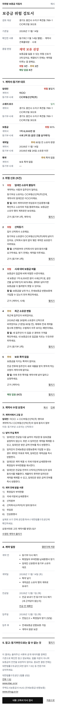

## 05. 검토서 · 예시 C · PC

대조표는 항목 | 계약서 | 등기부·시세 | 결과 네 칸 표. 위험 신호는 번호 · 판정 · 이름이 한 줄이고 내용은 제목 아래에 맞춘다.

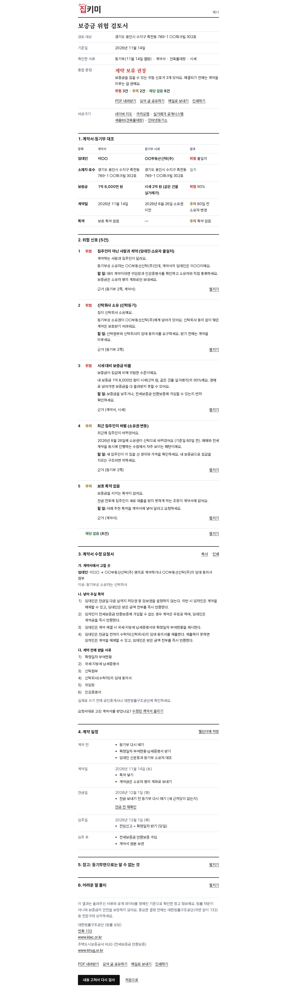

## 05. 검토서 · 예시 C · 모두 펼침

근거 원문 인용, '해당 없음 (8건)', '참고: 등기부만으로는 알 수 없는 것', '어려운 말 풀이'(이 검토서에 나온 말만 모은 풀이)를 모두 펼친 상태.

## 06. 검토서 · 확인 미완료

예시 A에서 임대인 이름을 지우고 다시 검사한 결과. 종합 판정 '확인 미완료'와 '빠진 내용 채우기' 링크, 대조표 임대인 줄은 확인 못 함.

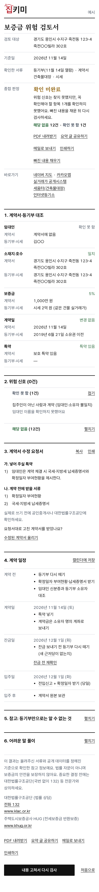

## 07. 검토서 첫 화면 · 예시 C · 휴대폰

문서 머리부터 휴대폰 한 화면(390×844) 만큼. 종합 판정 바로 아래에 보내기 줄과 바로가기가 함께 보인다.

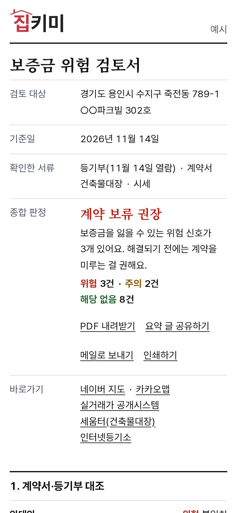

## 08. 계약서 수정 요청서 인쇄 · 예시 C

3절 '인쇄'로 나오는 A4 한 장. 머리글·버튼·다른 절 없이 대상, 작성일, 1. 고칠 곳, 2. 특약, 3. 받을 서류, 맺음말, 받는 분 · 요청인(서명) 줄만 나온다.

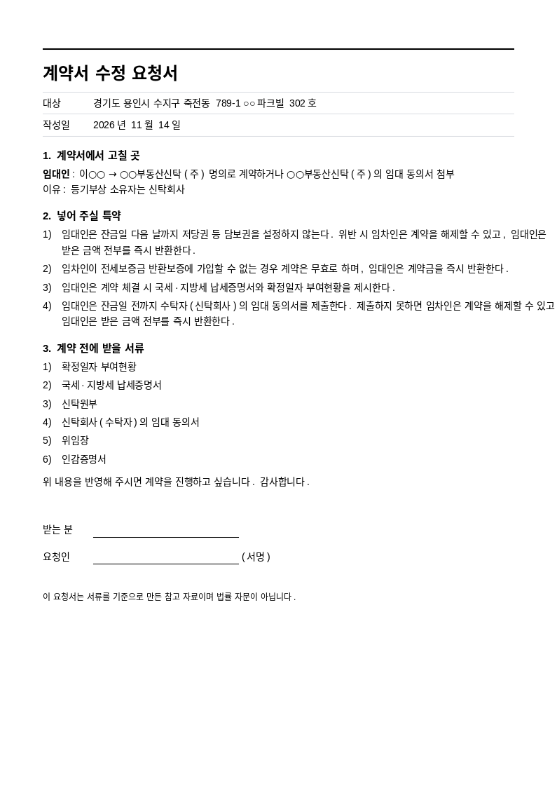

## 09. 검토서 · 계약서 없음

등기부만으로 검사한 결과. 대조표의 계약서 칸은 모두 '—', 표 아래 "계약서를 올리면 임대인·호수·특약을 대조할 수 있어요.", 3절 제목은 '계약 전 요청서'. 비교할 계약서가 없으므로 '수정된 계약서 올리기' 링크는 나오지 않는다.

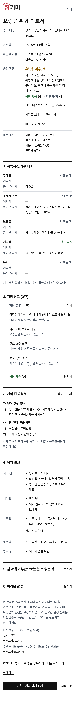

## 10. 계약 후 재확인 · 서류 올리기

시작 화면의 '이미 계약했다면: 계약 후 재확인'으로 연 화면. 오늘 뗀 등기부와 계약서(둘 다 필수)를 고르고 전송 고지에 체크하면 [서류 읽기]가 켜진다. 다음 단계에서 계약일·잔금일·입주일·열람 일시를 확인한다.

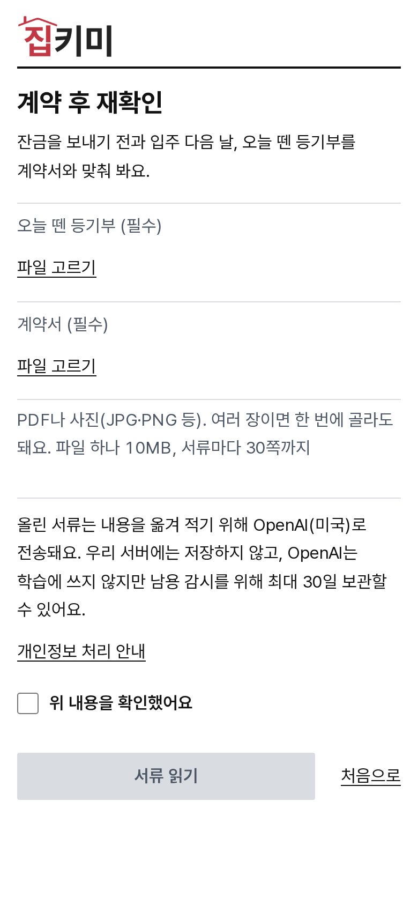

## 11. 계약 후 재확인서 · 휴대폰

예시 'A 집, 잔금 이틀 전 근저당이 생긴 경우'. 종합 판정 '잔금 보류 권장', 1절 계약 후 새로 생긴 권리(을구 근저당 1억 2,000만 원, 2026년 11월 27일 접수), 2절 특약 점검(맨 앞에 '위반', 그 아래 '계약서 특약' 원문 상자), 3절 할 일.

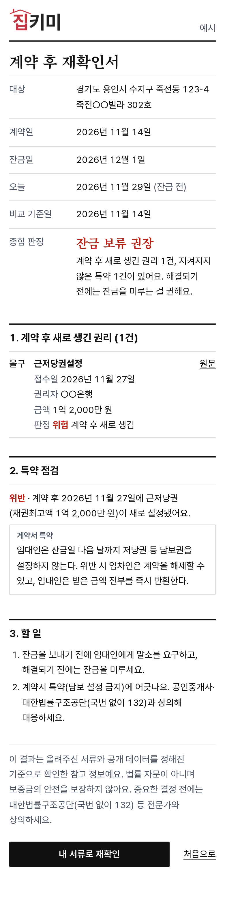

## 12. 계약 후 재확인서 · PC

같은 재확인서를 PC 폭에서. 새로 생긴 권리는 구분 · 등기목적 · 접수일 · 권리자 · 금액 · 판정 표.

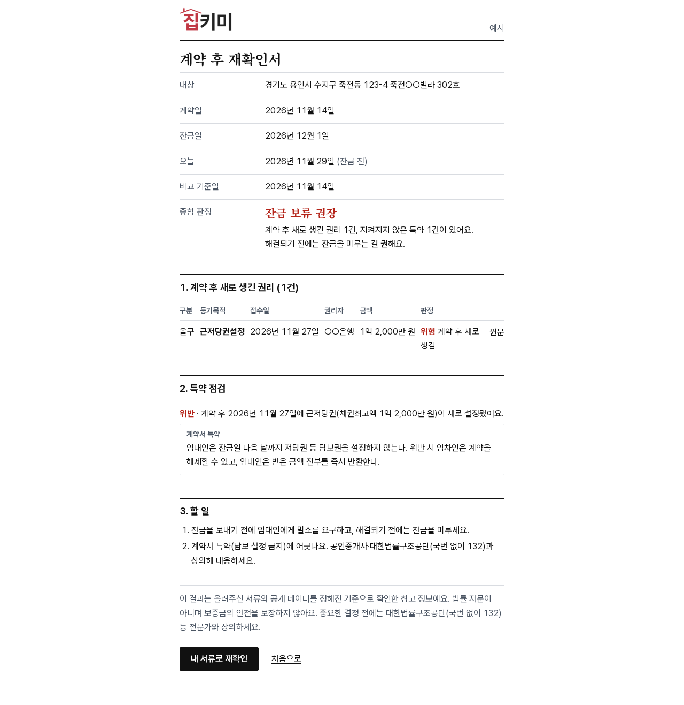

## 13. 수정 전·후 비교서 · 휴대폰

예시 'C 집, 요청서대로 계약서를 고친 경우'. 머리 표는 대상 → 요청 반영(가장 크게, 5건 중 5건 반영) → 남은 위험 → 종합 판정(계약 보류 권장, 수정 전과 같아요) → 개수 변화 → 기준일 순서다. 요청서를 다 반영해도 집 자체의 위험은 남는다는 것을 첫 화면에서 보여 준다. 1절 요청서 반영, 2절 위험 신호 변화(쉬운 이름), 3절 바뀐 계약 내용.

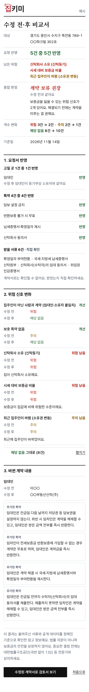

## 14. 수정 전·후 비교서 · PC

같은 비교서를 PC 폭에서. 남은 위험은 한 줄로 이어 쓰고, 위험 신호 변화는 규칙 | 수정 전 | 수정 후 | 변화 표, 바뀐 계약 내용은 항목 | 수정 전 | 수정 후 표.

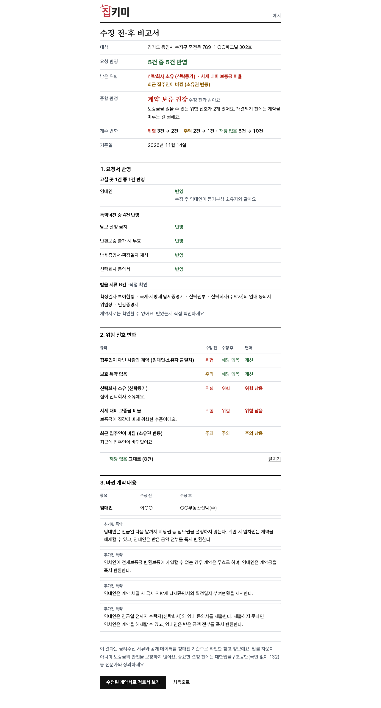

## 15. 수정된 계약서 올리기

예시 C 검토서 3절의 '수정된 계약서 올리기'로 연 화면. 고친 계약서 하나만 고르고 전송 고지에 체크하면 [비교하기]가 켜지고, 등기부와 직접 입력한 값은 방금 검사에 쓴 것을 그대로 쓴다.

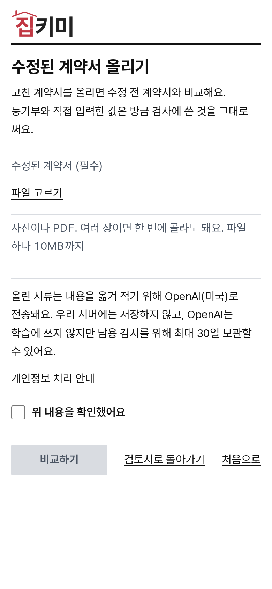

## 16. 개인정보 처리 안내

시작 화면 아래와 전송 고지의 링크로 여는 화면. 받는 정보 · 쓰는 목적 · 보내는 곳(올린 파일만 OpenAI(미국)로, 시세·건축물대장은 동 이름·지역 번호·번지만 공공 API로) · 보관 기간(우리 서버는 저장하지 않음) · 개인정보를 지키는 방법(계약서 사진·PDF의 번호 자동 가리기와 네모 가리기, 결과 화면의 주민등록번호·전화번호 가림, 가리기 예시 사진) · 동의하지 않을 때.

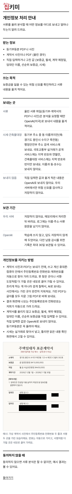

## 17. 보내기 전에 가리기 · 휴대폰

계약서 사진을 고르면 가리기 창이 바로 열리고, 기기 안의 글자 읽기(OCR)로 주민등록번호·전화번호를 찾아 먼저 검게 가린다(자동 4군데). 그 위에 서명 자리 두 곳을 네모로 끌어 더 가린 상태(가린 곳 6군데, 자동 4군데 포함). 사진 오른쪽 위의 − 100% + 로 키울 수 있다. 가린 사진만 전송된다. 되돌리기 · 다 지우기.

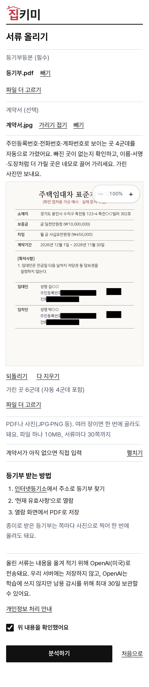

## 17. 보내기 전에 가리기 · PC

같은 화면을 PC 폭에서 마우스로.

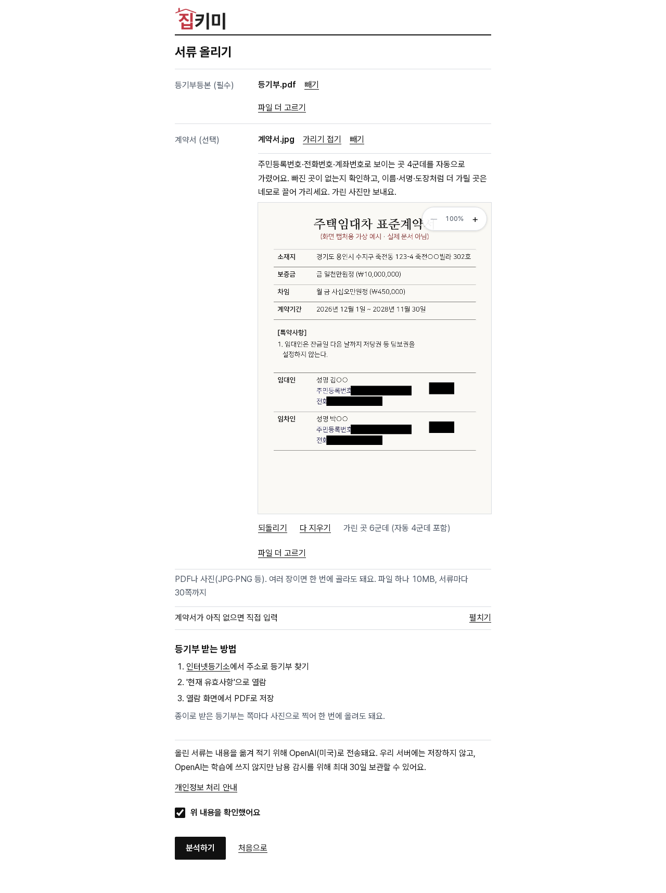

## 18. 보내기 전에 가리기 · 확대

[+]를 두 번 눌러 200%로 키운 모습. 작은 글자도 정확히 가릴 수 있고, 휴대폰은 두 손가락으로 끌어(컴퓨터는 스크롤) 사진을 옮긴다. −/+는 사진을 옮겨도 그 자리에 있다.

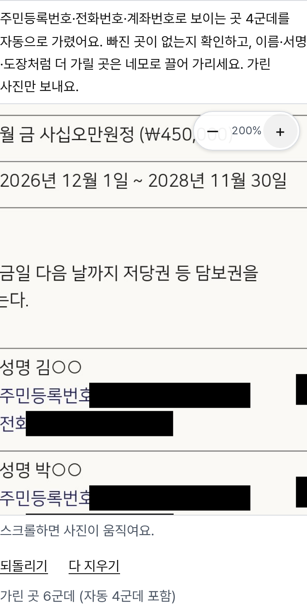

## 19. PDF 계약서 가리기

계약서 PDF(demo-docs의 C-계약서.pdf)를 고른 모습. PDF를 기기 안에서 쪽마다 그림으로 바꾸고, 글자 층에서 주민등록번호·전화번호·계좌번호 모양을 찾아 가린다(스캔 PDF는 OCR로). 가린 곳이 있으면 글자를 모두 지운 그림 PDF로 다시 만들어 보내고, 없으면 원래 PDF를 그대로 보낸다. 여러 쪽이면 위에 '1쪽 (1) · 2쪽 (3)'처럼 쪽을 골라 더 가린다.

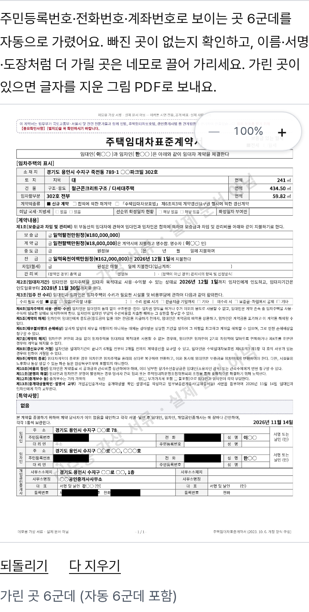

## 20. 어려운 말 풀이

예시 C 첫 위험 신호에서 점선 밑줄 '위임장'을 누른 모습. 그 글 끝에 한두 줄 풀이가 나오고, 다시 누르면 닫힌다. 같은 말은 글마다 처음 나온 곳에만 밑줄을 친다.

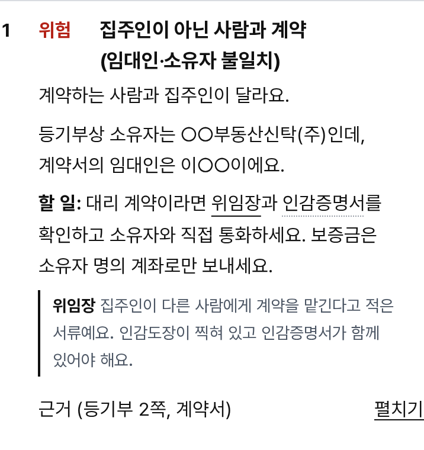

## 21. 검토서 PDF 파일

[PDF 내려받기](휴대폰은 [PDF로 공유하기])로 만든 A4 PDF. 접힌 근거·목록을 펼치고 버튼·밑줄·펼친 풀이는 뺀다. 쪽마다 아래에 문서 이름과 쪽 번호가 있고, 마지막 쪽에 '어려운 말 풀이'가 들어간다. 서버로 보내지 않고 브라우저 안에서 만든다.

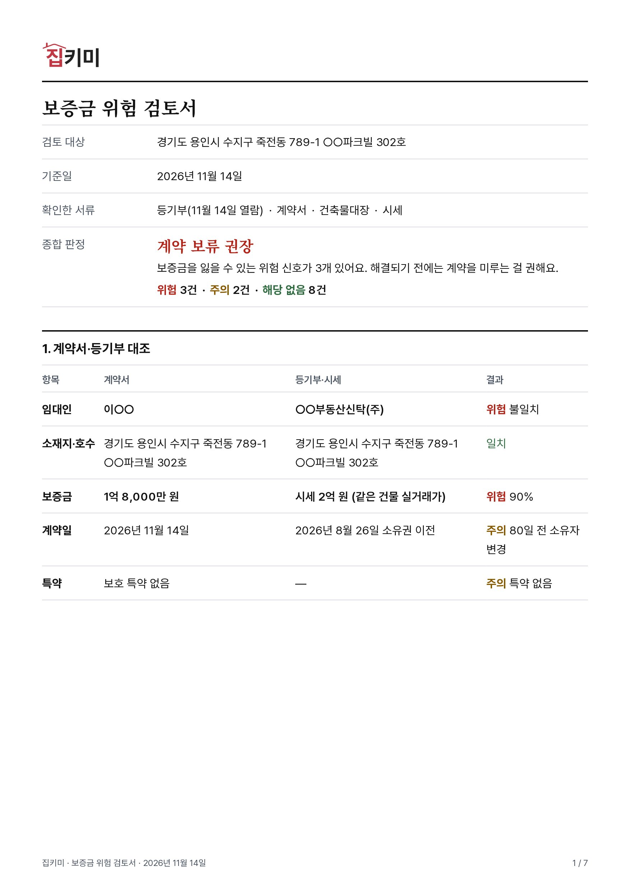

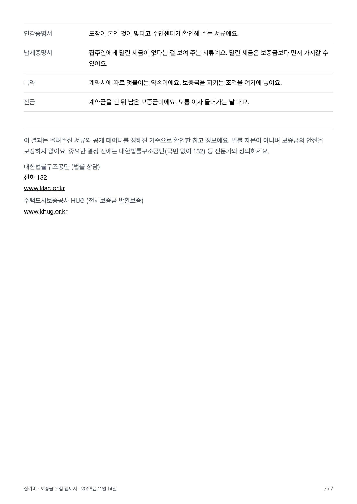

## 22. 읽은 내용 확인 · 원문 보기

실제로 서류를 올렸을 때 등기부 제목 오른쪽의 [원문 보기]를 누른 모습. 올린 서류를 '등기부 1쪽, 2쪽…'처럼 제목 아래에 펼쳐서 AI가 읽은 칸과 바로 맞춰 본다. 쪽 번호는 근거의 '등기부 2쪽'과 같다. 계약서는 가려서 보낸 그대로 보여 준다.

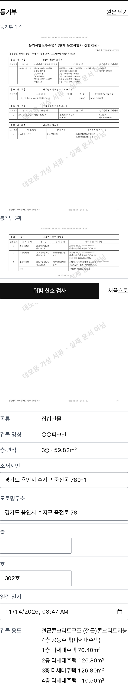
